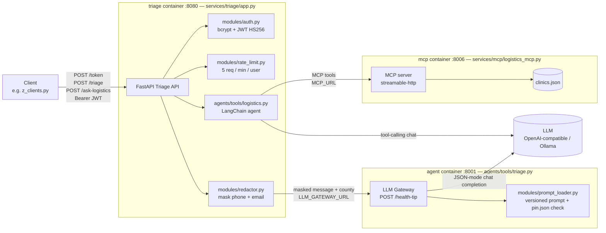

# Architecture

AfyaPlus — integrated AI health-operations system. Three containers (see `docker-compose.yml`): a public **triage API**, an internal **LLM gateway (triage agent)**, and a **logistics MCP server**.

## Diagram

### Request flows
1. **Login** — `POST /token` checks the bcrypt hash and returns a 30-minute JWT.
2. **Triage** — `POST /triage` → JWT check → rate limit → PII masking → gateway `POST /health-tip` → LLM (temperature 0, 60 max tokens, JSON mode) → response validated against `{urgency: low|medium|high, advice}` → API adds `handled_for`.
3. **Logistics** — `POST /ask-logistics` → JWT check → LangChain agent (recursion limit 8) discovers tools on the MCP server and calls them: `check_stock`, `plan_delivery_route`, `get_delivery_eta`, resource `clinics://directory`.

### Failure handling
| Condition | Returned to client |
|---|---|
| Missing / expired / invalid token | 401 |
| More than 5 requests per minute | 429 |
| Gateway unreachable or LLM down | 503 |
| LLM output not matching the response schema | 502 |
| Prompt hash or version differs from `pin.json` | gateway `/health` returns 503 `degraded` |

## Module boundaries
- **services/triage/** — public API boundary: auth, rate limiting, PII redaction, validated JSON in/out (Pydantic length limits). Only service exposed to clients (port 8080).
- **services/triage/prompts/** — versioned system prompts (`agent_triage_v1.1.0.txt`, `agent_logistics_v1.1.0.txt`) and `pin.json` holding the pinned version and SHA-256.
- **services/mcp/** — logistics MCP server; the only component that reads clinic stock and location data.
- **agents/tools/triage.py** — LLM gateway: the only component that sends patient text to the model for triage. Refuses to report healthy if the prompt drifts from its pin.
- **agents/tools/logistics.py** — LangChain tool-calling agent; reaches data only through MCP tools.
- **agents/router.py** — keyword router over `config.json` (`triage` vs `ask-logistics`, defaults to `triage`). Unit-tested; not yet wired into the API.
- **modules/** — shared cross-cutting code: `auth`, `rate_limit`, `redactor`, `prompt_loader`.
- **images/** — one Dockerfile per container (`Dockerfile.triage`, `Dockerfile.agent`, `Dockerfile.mcp`); `python:3.12-slim`, each copying only the files it needs.
- **config.json** — project name, tool list, routing keywords, endpoint names, fixture size.
- **capstone_docs/** — proposal, integration map, fixtures, evals (`golden.jsonl`, `run_eval.py`) and helper scripts.
- **tests/** — unit (router, triage, fixture diagnostics), integration (`/health`), security smoke.
- **docs/** — this pack.

### Configuration
Secrets and endpoints come from env files (`config/app.env`, `config/agent.env`; template in `.env.example`): `JWT_SECRET`, `LLM_GATEWAY_URL`, `MCP_URL`, `LLM_BASE_URL`, `LLM_API_KEY`, `LLM_MODEL`, `AGENT_TRIAGE_PROMPT_VERSION`. Containers carry `afyaplus.*` labels (service, version, cost-center `clinical-ai`, env, owner) for cost tracking. The agent and triage containers have health checks and are limited to 1 CPU / 512 MB.

## Data boundaries
- **Clinical data (patient messages)** — enters only via `/triage`. Phone numbers (Kenyan `+254` / `07` / `01`) and email addresses are masked **before** the text leaves the triage container, so the gateway and LLM never see raw contact details. Nothing is stored.
- **Operational data (`clinics.json`)** — clinic IDs, coordinates and stock levels. Kept inside the MCP container and reachable only through MCP tools with whitelisted inputs (`VALID_ITEMS`, known clinic IDs). It never mixes with patient data.
- **Why separate:** the triage path carries sensitive health information, while logistics is non-personal operational data. Keeping them in separate services, with separate agents, means a logistics question can't expose patient text and a triage prompt can't query inventory.
- **Fixtures** — `capstone_docs/fixtures/triage_messages_sample.jsonl` is synthetic (about 300 rows, generated by `make_fixture.py`). It holds no production data and contains only triage records, with no logistics rows mixed in.
- **Credentials** — the demo user (`mercy`) password is bcrypt-hashed in memory. JWTs are signed with `JWT_SECRET` from env and never committed.
